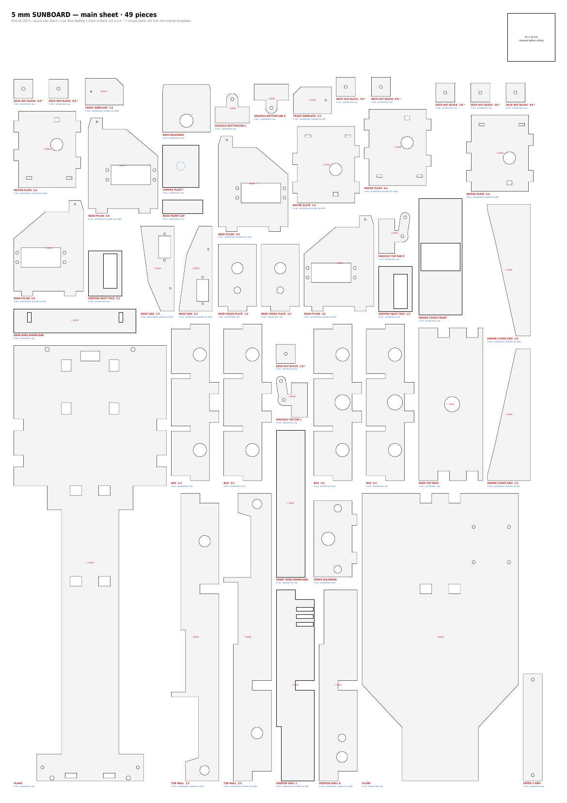

# Sunboard chassis v1 (hand-cut)

The car's chassis and body: **69 pieces** of PVC sunboard cut with a blade and glued with 743 cyanoacrylate and Araldite. No saw, laser cutter or 3D printer needed.



## Files

| File | What it is |
|---|---|
| `templates/sunboard_templates_PRINTSHOP_A1_A4.pdf` | Cover + **one A1 sheet** (49 pieces, 5 mm) for a print shop + **three A4 pages** to print at home (13 small 5 mm parts, 7 parts in 2–3 mm) |
| `templates/sunboard_templates_HOME_A4_tiled.pdf` | Same parts, with the A1 sheet split into **16 A4 tiles** (10 mm overlap, crosshairs every 50 mm) |
| `templates/cut_list.csv` | Every piece with its size, sheet thickness and notes |
| `source/parts.json` | Piece outlines in car coordinates (x rearward from the nose, y + = left, z up, mm) |
| `source/make_templates.py` | Regenerates the PDFs and cut list from `parts.json` |
| `source/render_chassis.py` | Renders the README picture from `parts.json` |

Regenerate after changing `parts.json`:

```bash
pip install reportlab shapely rectpack matplotlib
python3 source/make_templates.py
python3 source/render_chassis.py ../../DOCS/images/chassis_render.png
```

## Materials

| Item | Amount |
|---|---|
| 5 mm PVC sunboard | about 0.8 m² (half an 8 × 4 ft sheet) |
| 2–3 mm PVC sunboard | 1 × A3: nose top and bottom, engine-cover top, four flaps |
| 743 superglue (cyanoacrylate) | edge joints |
| Araldite | laminations, bearings, nuts, servo tabs |
| 4 × 606ZZ bearings, 2 × M6 × 50, M3 screws, nuts and penny washers | see the build guide |

**Sunboard only, never paper-faced foam board:** cyanoacrylate dissolves the polystyrene core. Test a drop on an offcut first.

## Printing and cutting

1. Print at **100 % / actual size**. Measure the scale square on every page (50 mm on A1, 30 mm on A4) before cutting anything.
2. Measure your sheet with calipers. Slots are drawn for exactly 5.0 mm and 3.0 mm.
3. Stick the paper on, cut through it along a steel rule: blade vertical, 3–4 light passes, snap to a fresh blade edge often.
4. Cut one slot first and test it with an offcut.
5. Make holes with a circle cutter, an awl or a hand drill. **Never a hot tool:** hot PVC gives off acid fumes.

**Reading the sheets:** black = cut. Blue dashed = mark, a hole to drill to suit, or a bend line (score, don't cut). Red = part name and copy number. `← NOSE` shows which end faces forward. The printed face is the **top** of horizontal parts, the **outside** of side parts and the **rear** of cross parts.

**Laminated parts:** motor plates, rear pylons, BH3/BH4, rear crash plate and deck nut blocks are 2 layers (10 mm); each front knuckle is 3 layers (15 mm) with two 606ZZ bearings set in Araldite.

## Corrections in this version

Compared with the first printed set:

- **FRONT ENDPLATE** is 40 mm long, not 48. Uncut, the tyres come within 3 mm of the endplates at full lock.
- **ELECTRONICS DECK** screw holes moved onto the deck nut blocks: x = 320 / 385 mm, y = +50 (left) and −40 (right).
- Three parts that were never in the 3D model are drawn as **simple blanks** (marked `*`): DECK NUT BLOCK × 8 (20 × 20 mm), ENCODER WASHER PLATE (30 × 30 mm) and CAMERA PLATE (38 × 44 mm; mark the lens hole from your own ESP32-CAM).

## Key geometry

| | |
|---|---|
| Length / wheelbase | 560 mm / 340 mm (front axle x = 110, rear axle x = 450) |
| Track | front 216 mm, rear 230 mm |
| Steering | 180° servo in a bridge across the tub, ±30°, about 8° Ackermann |
| Front flaps | 2 × SG90 inside the nose sides |
| Rear flaps | 2 × MG996R (with pot feedback) on 10 mm pylons |
| Ground clearance | wheel radius − 25 mm |

Interactive 3D model: [F1 VCU Car Model](https://claude.ai/artifact/3ANfjPTYQSL9twR6ybkE5o).
