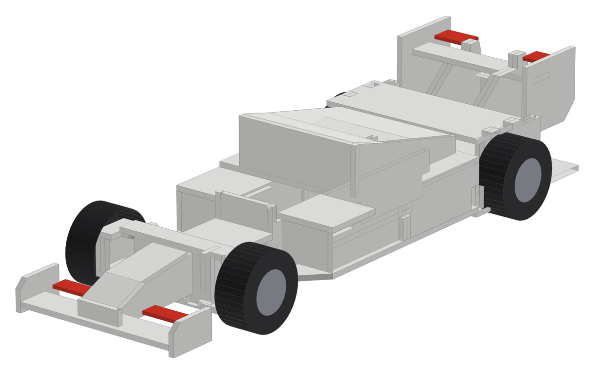
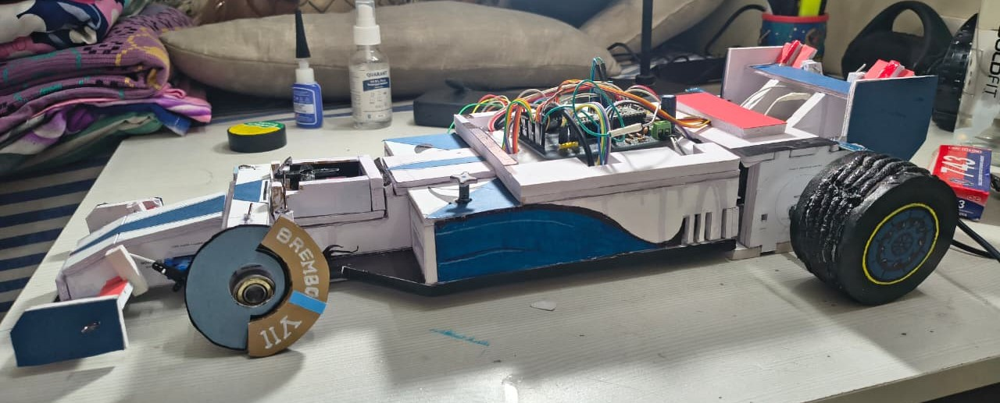
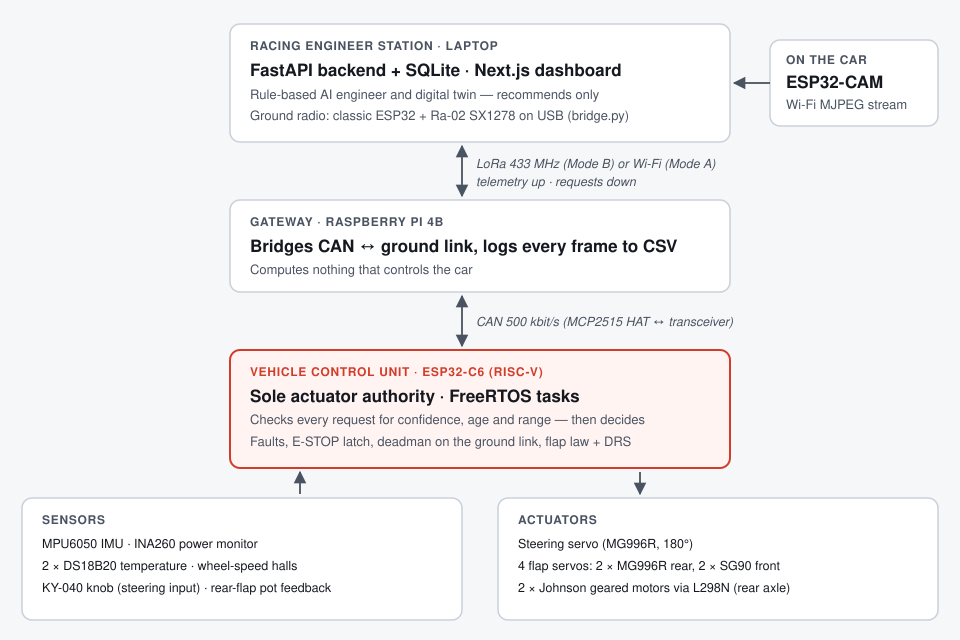
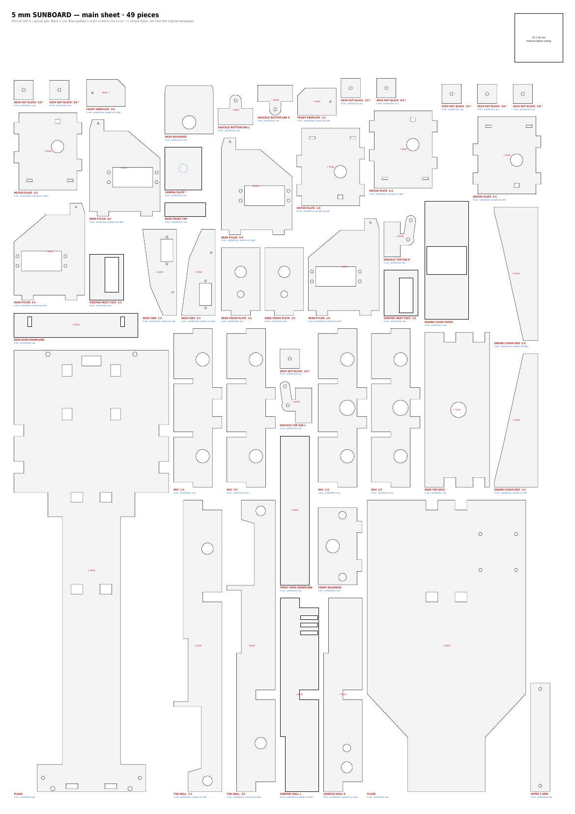

<div align="center">

# RISC-V Motorsport VCU

**AI-Enabled RISC-V Based Motorsport Electronics Platform with Active Aerodynamics, Telemetry and Digital Twin for a 1:10 Scale Formula-Style RC Car**

Final-year major project · B.E. Electronics and Communication Engineering · BMS College of Engineering, Bengaluru · 2026

-d23c2a)
-15191f)


<!-- Replace this render with a real photo of the car once you add one to MEDIA/photos/ -->


<sub>The chassis, rendered from the same outlines as the cut templates in <code>MECHANICAL/</code>. Red = the four active-aero flaps.</sub>



</div>

---

## What it is

A scaled Formula-style car whose electronics are laid out like a real race car's:

- a **vehicle control unit (VCU)** on a RISC-V ESP32-C6 that reads every sensor and drives every actuator,
- a **CAN bus** to a Raspberry Pi gateway,
- a **LoRa / Wi-Fi telemetry link** to a race-engineer station on a laptop, with a live dashboard, a rule-based AI race engineer and a digital twin.

The research feature is **asymmetric active aerodynamics**: four independently driven wing flaps. On a straight all four sit at maximum; in a corner the inside pair drops toward flat in proportion to the steering, and a **DRS** button flattens all four.

**Safety rule built into the architecture:** the AI and the laptop only *recommend*. Every request from the Pi or the dashboard (start a run, run the motor, change mode, calibrate, E-STOP reset) is checked by the VCU for confidence, age and range, and the VCU alone decides.

<!--
## Photos
Add your own photos to MEDIA/photos/ and un-comment this table.

| The car | VCU board | Dashboard |
|---|---|---|
|  |  |  |
-->

## System architecture



| Layer | Hardware | Software | Role |
|---|---|---|---|
| Engineer station | Laptop + ground radio (classic ESP32 + Ra-02 SX1278) | FastAPI + SQLite backend, Next.js dashboard, `bridge.py` | Telemetry, AI engineer, digital twin, run control *requests* |
| Gateway | Raspberry Pi 4B + MCP2515 CAN HAT + Ra-02 | `main.py` | Bridges CAN ↔ ground link, logs CSV. Controls nothing. |
| VCU | ESP32-C6 (RISC-V), custom PCB | Arduino-ESP32 3.3.x, FreeRTOS tasks | Sensors, actuators, faults, E-STOP, flap law, DRS |
| Camera | ESP32-CAM | MJPEG over Wi-Fi | Onboard video, relayed by the backend |

## Repository layout

```
├── HARDWARE/                 firmware and everything that runs on a board
│   ├── esp32/main_updated_corrected__1_/   VCU sketch (.ino, vcu_logic.h, vcu_hw_profile.h, vcu_calibration.h)
│   ├── raspberry_pi/         gateway (main.py) and setup scripts
│   ├── Ground Station/       bridge.py, drive_client.py, ground LoRa modem
│   ├── esp32_cam/            camera sketch
│   ├── pcb_prototype/        prototype PCB Gerbers + 1:1 fit-check PDF
│   ├── pcb_revB/             rev B PCB (Infineon parts): KiCad, Gerbers, BOM, CPL
│   └── tests/                hardware tests, virtual_car.py (real vcu_logic.h on a virtual CAN bus)
├── SOFTWARE/
│   ├── backend/              FastAPI, AI engineer, digital twin, camera relay
│   ├── dashboard/            Next.js race-engineer dashboard
│   ├── analysis/             offline log analysis
│   └── Documentation/        wiring, change logs, demo run guide
├── MECHANICAL/
│   └── chassis_sunboard_v1/  1:1 cut templates (PDF), cut list, template generator
├── AERO/                     CFD set-up, results and plots for the flaps
├── DOCS/                     report, presentation, README images
├── MEDIA/                    photos and demo video links
├── HOW_TO_RUN.md             exact commands for every machine
├── SAFETY.md                 read before powering anything
└── CHANGELOG.md
```

## Try it without the car

The virtual car compiles the **real** `vcu_logic.h` for your laptop and runs it behind the real Pi gateway on a virtual CAN bus, so the whole stack runs with no hardware:

```bash
# 1. backend   (exact flags: HOW_TO_RUN.md)
cd SOFTWARE/backend && uvicorn app.main:app --host 0.0.0.0 --port 8000
# 2. dashboard
cd SOFTWARE/dashboard && npm install && npm run dev        # http://localhost:3000
# 3. virtual car + gateway
python3 HARDWARE/tests/virtual_car.py
```

## Running the real car

Run order: **backend → dashboard (Live Mode) → `bridge.py` → Pi gateway → camera.** Commands, IP addresses and Mode A / Mode B options are in [`HOW_TO_RUN.md`](HOW_TO_RUN.md). Wiring is in [`SOFTWARE/Documentation/VCU_final_connections.txt`](SOFTWARE/Documentation/VCU_final_connections.txt) (prototype) and `PCB_revB_connections.md` (rev B).

**Flashing the VCU:** Arduino IDE, board *ESP32C6 Dev Module*, *USB CDC On Boot: Enabled*, esp32 core 3.3.x. Servo end points live in `vcu_calibration.h`; the build is chosen by one line in `vcu_hw_profile.h`:

```c
#define VCU_HW_PROFILE VCU_HW_PROFILE_PROTOTYPE   // hobby-sensor PCB
// #define VCU_HW_PROFILE VCU_HW_PROFILE_PCB_REV_B // Infineon rev B PCB
```

> ⚠️ Read [`SAFETY.md`](SAFETY.md) first. 12 V reaching the logic side killed one ESP32-C6, and USB back-feed killed a laptop during this project.

## Chassis

The body is cut by hand from PVC sunboard and glued with cyanoacrylate and Araldite: 69 pieces, no 3D printing or laser cutting.



- **Print-shop set:** [`sunboard_templates_PRINTSHOP_A1_A4.pdf`](MECHANICAL/chassis_sunboard_v1/templates/sunboard_templates_PRINTSHOP_A1_A4.pdf): one A1 sheet + three A4 pages
- **Home printer:** [`sunboard_templates_HOME_A4_tiled.pdf`](MECHANICAL/chassis_sunboard_v1/templates/sunboard_templates_HOME_A4_tiled.pdf): the A1 sheet as 16 A4 tiles
- **Cut list:** [`cut_list.csv`](MECHANICAL/chassis_sunboard_v1/templates/cut_list.csv)
- **Interactive 3D model:** [F1 VCU Car Model](https://claude.ai/artifact/3ANfjPTYQSL9twR6ybkE5o)

Print at 100 %, check the scale square, then follow [`MECHANICAL/chassis_sunboard_v1/README.md`](MECHANICAL/chassis_sunboard_v1/README.md).

<br clear="right">

## Status: what is measured and what is modelled

| Item | Status |
|---|---|
| Full chain VCU → CAN → Pi → LoRa → ground → dashboard | ✅ Working on the car |
| Knob steering, asymmetric flap law, DRS, servo calibration | ✅ Working on the car (FW 2.3.3, final demo) |
| IMU, INA260, DS18B20s, LoRa, CAN, ESP32-CAM on the dashboard | ✅ Working on the car |
| Driving under its own power | ⚠️ Not demonstrated: the 12 V / 2.2 A adapter is enough only for the dyno demo. Real driving needs a 3S LiPo or a 5–10 A supply. |
| Wheel speed | ⚠️ The hobby hall sensors read badly. From FW 2.3.4 the rear speed is **computed from motor duty**, not measured. |
| Flap angles vs downforce/drag, circuit speeds | 📐 Modelled (CFD + digital twin), not measured on the car |
| AI drives the car (`/ws/ai-command`, FW 2.3.12) | 🧪 Tested on the virtual car only. Off by default (`VCU_AI_COMMAND_LINK=1`). |
| PCB rev B (Infineon BTN8982TA, BTS7004, TLE4941plusC, TLS4125) | 📐 Designed, not fabricated |
| Tyre diameter | Assumed 90 mm in the speed model |

Tests in the repo: 63 hardware/firmware-logic tests, 77 backend tests, analysis tests; the dashboard type-checks, lints and builds clean.

## Team

| | |
|---|---|
| Parikshit Srivats Bharadwaj | [@Rickybro201](https://github.com/Rickybro201) |
| Dhyan Raju Poojary | |
| Gauranga Datta | |
| Dhanushya Shetty | |

**Guide:** Dr Karthikeya G S, Department of ECE, BMS College of Engineering.

## Acknowledgements

- **Infineon Technologies** for sample ICs and sensors used in the rev B design.
- **Centre of Excellence in Design (D-CoE), IISc Bengaluru** for their support of the project.
- **BMS College of Engineering**, Department of Electronics and Communication Engineering.

## License

Code is released under the [MIT License](LICENSE). If you use this work, please cite it ([`CITATION.cff`](CITATION.cff)).
